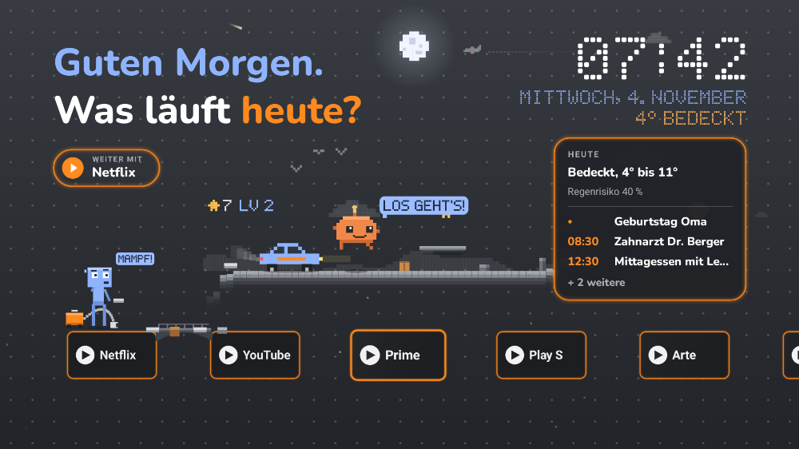
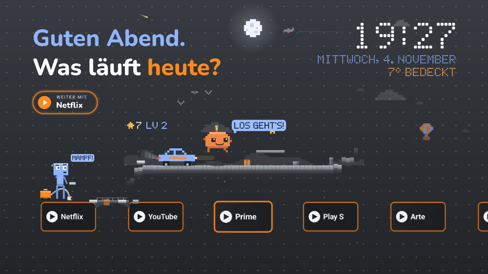
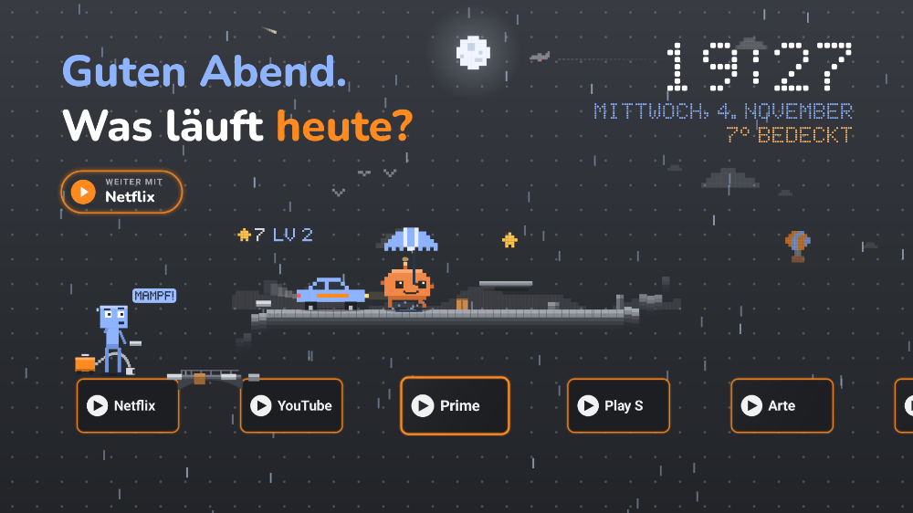
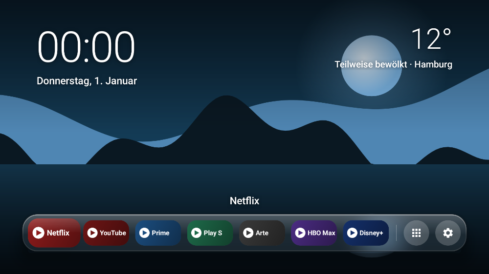

# BetterTV

**Eine werbefreie, ruhige Startseite für Android TV und Google TV.** Statt Empfehlungs- und
Werbezeilen: deine Apps, Uhr, Wetter, deine Termine – und ein kleines Pixel-Jump-and-Run.

**Website & Download:** [fijiwasser-source.github.io/BetterTV](https://fijiwasser-source.github.io/BetterTV/)



- **Keine Werbung, keine Empfehlungen, kein Tracking.** Einstellungen bleiben auf dem Gerät.
- **Große App-Kacheln** mit Fernbedienung bedienbar, Zifferntasten **1–9** starten Apps direkt.
- **Uhr, Datum und Wetter** (Open-Meteo: ohne Konto, ohne API-Schlüssel).
- **Tagesübersicht „HEUTE“:** morgens das Wetter für den Tag und deine Termine (Google Kalender
  oder jeder andere iCal-Kalender).
- **Handy-Fernbedienung** als Web-App – ohne App-Download.
- **Pixel**, ein eigenes Pixel-Maskottchen, läuft in einem Endlos-Jump-and-Run – mit Wetter,
  Verfolgungsjagd, Musik und Sounds. Selbst spielen mit den Farbtasten.
- Einheitliche **App-Symbol-Stile** (Original, Dunkel, Orange, Blau, Glas).
- Läuft ab **Android 5** – getestet auf einem Sony BRAVIA KD-65XD7505 (Android TV 6/7).

| Abend, Symbole „Dunkel“ | Regen im Spiel | Design „Glas“ |
|---|---|---|
|  |  |  |

*Vorschaubilder mit Platzhaltern für App-Banner und Termine.*

## Installieren

1. **APK herunterladen:** unter [Releases](../../releases) die neueste `bettertv-X.Y.apk`.
2. **Am Fernseher:** Entwickleroptionen einschalten (7× auf *Build* klicken – Sony:
   *Einstellungen → Info → Build*, Google TV: *Einstellungen → System → Über → Android TV OS-Build*),
   dann in den Entwickleroptionen **USB-Debugging** an.
3. **Am Computer** [adb (Platform Tools)](https://developer.android.com/tools/releases/platform-tools)
   herunterladen und im Ordner `platform-tools` ausführen:

   ```bash
   ./adb connect <IP-des-Fernsehers>        # am TV "Zulassen" bestätigen
   ./adb install -r bettertv-X.Y.apk
   ```

4. **Home-Taste auf BetterTV legen** – mit dem Skript aus diesem Repo:

   ```bash
   ./tools/tv-setup.sh auto home      # Original-Startseite deaktivieren (nicht löschen)
   ./tools/tv-setup.sh auto restore   # alles wieder wie vorher
   ```

   Die IP findet `python3 tools/find-tv.py` (oder am TV unter *Einstellungen → Netzwerk*).
   Systemupdates können die Google-Startseite wieder aktivieren – dann `home` erneut ausführen.

Danach in BetterTV unter **Einstellungen (Zahnrad) → Wetter-Ort** deine Stadt eintragen.


<details><summary>Alle Befehle von <code>tools/tv-setup.sh</code></summary>

```bash
./tools/tv-setup.sh auto install            # BetterTV installieren (APK=/pfad/zur.apk)
./tools/tv-setup.sh auto home               # Home-Taste -> BetterTV
./tools/tv-setup.sh auto dns                # Werbeblocker-DNS (ab Android 9; sonst Anleitung)
./tools/tv-setup.sh auto dns-off            # DNS wieder automatisch
./tools/tv-setup.sh auto wallpaper bild.jpg # eigenes Hintergrundbild (Design "Glas")
./tools/tv-setup.sh auto status             # Kontrolle
./tools/tv-setup.sh auto restore            # Original-Startseite wieder an
```

Statt `auto` geht auch die IP-Adresse des Fernsehers.
</details>

## Bedienung

| Wo | Taste | Funktion |
|---|---|---|
| Startansicht | ◀ ▶, OK | App wählen und öffnen |
| | **1–9** | App an dieser Stelle starten |
| | OK lange drücken | Verschieben · Vom Start entfernen · Ausblenden · App-Info |
| | Farbtaste oder **0** | Selbst spielen (jeder Druck = Sprung) |
| | Zurück | zur ersten App |
| Alle Apps | OK lange drücken | Zum Start hinzufügen · Ausblenden · App-Info |
| überall | Home | Startansicht |

**Einstellungen** (Zahnrad am Ende der App-Reihe): Design (Abend / Glas), Animationen
(Voll / Sparsam / Aus), Wetter im Spiel, Musik & Sounds, App-Symbole, Wetter-Ort,
Tagesübersicht, Handy-Fernbedienung, ausgeblendete Apps.

## Tagesübersicht „HEUTE“

Morgens von 5 bis 11 Uhr (oder immer, siehe *Einstellungen → Tagesübersicht*) steht unter der
Uhr das Wetter für den ganzen Tag und deine Termine von heute.

**Kalender verbinden:** am Computer [calendar.google.com](https://calendar.google.com) → ⚙︎
*Einstellungen* → links deinen Kalender wählen → *Kalender integrieren* →
**Privatadresse im iCal-Format** kopieren. Dann in der Handy-Fernbedienung auf ⚙︎ tippen und
die Adresse unter „Google-Kalender“ einfügen. Jeder andere iCal-Link (iCloud, Outlook, Nextcloud)
geht auch.

> Die Privatadresse ist wie ein Passwort: wer sie hat, sieht deine Termine. Sie wird nur auf dem
> Fernseher gespeichert. Falls sie in falsche Hände gerät, bei Google auf *Zurücksetzen* klicken.

## Handy-Fernbedienung

1. Am Handy im selben WLAN `http://<IP-des-TVs>:8765` öffnen (steht auch in BetterTV unter
   *Einstellungen → Handy-Fernbedienung*).
2. **PIN anzeigen** antippen, die PIN vom Fernseher eingeben.
3. Als App ablegen: iPhone: Safari → *Teilen → Zum Home-Bildschirm*; Android: Chrome → ⋮ →
   *Zum Startbildschirm hinzufügen*.

Touchpad wie bei der Siri Remote, Zurück, Home, Play/Pause, Lautstärke, Eingang, Aus und
App-Kacheln. **Pfeile, OK, Zurück, Eingang und Aus** laufen bei Sony über die Netzwerksteuerung:
einmalig am TV *Einstellungen → Netzwerk → Heimnetzwerk-Setup → IP-Steuerung →
Authentifizierung „Normal und Pre-Shared Key“* und den gewählten Code in der Web-App unter ⚙︎
eintragen.

Nur im Heimnetz erreichbar, Zugriff nur nach PIN-Kopplung (nach 5 falschen PINs wird eine neue
nötig). Die Verbindung ist unverschlüsselt (HTTP) – für ein privates Heimnetz gedacht, nicht für
offene WLANs.

## Datenschutz

BetterTV verbindet sich nur mit:

- **Open-Meteo** (api.open-meteo.com) für das Wetter – übertragen werden nur die Koordinaten des
  eingestellten Orts.
- **deiner Kalender-Adresse**, wenn du eine einträgst.

Keine Analyse, keine Werbung, kein Konto. Alle Einstellungen bleiben auf dem Fernseher.

## Werbung im restlichen System

| Maßnahme | Wo | Effekt |
|---|---|---|
| Privates DNS `dns.adguard-dns.com` | `tools/tv-setup.sh auto dns` (ab Android 9) | Blockt Werbe- und Tracking-Server systemweit |
| Werbe-ID löschen | *Einstellungen → Datenschutz → Werbung* | Keine personalisierte Werbung |
| Hersteller-Tracking aus | „Viewing Information“, „ACR“, „Inhaltserkennung“, Samba TV | Stoppt die Auswertung, was du schaust |

Ehrlich gesagt: DNS-Blocker entfernen **keine YouTube-Werbung** und keine Werbung, die
Streamingdienste in ihre Abos einbauen.

## Selbst bauen

Android SDK und JDK 17 nötig.

```bash
./gradlew testDebugUnitTest      # Unit-Tests
./gradlew lintDebug              # Lint
./gradlew recordPaparazziDebug   # Vorschaubilder neu rendern
./gradlew assembleDebug          # -> app/build/outputs/apk/debug/app-debug.apk
```

Klänge und Musik sind selbst erzeugt: `python3 tools/make_audio.py` schreibt sie nach
`app/src/main/res/raw/`.

<details><summary>Aufbau des Codes</summary>

- `MainActivity` – Startansicht, Einstellungen, Wetter, Tagesübersicht
- `Mascot`, `HelperLayer`, `SkyLayer` – Jump-and-Run, Schluck und Pixel-Himmel
- `AppLoader`, `AppOrder`, `Favorites`, `TileAdapter`, `IconStyle` – Apps, Reihenfolge, Symbol-Stile
- `CalendarIcs`, `DayPanel` – iCal-Kalender (mit Serienterminen) und „HEUTE“-Feld
- `Weather` – Open-Meteo, `Prefs` – lokale Einstellungen
- `remote/RemoteHttp` (HTTP-Server mit PIN-Kopplung), `remote/SonyIrcc` (Sony-Tasten),
  `remote/AndroidBackend`, `remote/RemoteService`; Web-App in `app/src/main/assets/remote/`
</details>

## Veröffentlichen (für Betreuer)

Releases werden automatisch gebaut, wenn ein Tag `v*` gepusht wird
(`.github/workflows/release.yml`). Vorher `versionCode` und `versionName` in
`app/build.gradle` erhöhen. Die APK wird mit dem Release-Schlüssel aus den Repository-Secrets
signiert: `BETTERTV_KEYSTORE_BASE64`, `BETTERTV_KEYSTORE_PASSWORD`, `BETTERTV_KEY_ALIAS`,
`BETTERTV_KEY_PASSWORD`. Den Schlüssel nie verlieren – ohne ihn lassen sich Updates nicht mehr
über eine installierte Version spielen.

## Lizenz und Hinweise

[MIT](LICENSE). Schrift Nunito: SIL Open Font License 1.1. Alle Figuren, Grafiken und Klänge sind
eigene Werke.

BetterTV ist ein unabhängiges Projekt und steht in keiner Verbindung zu Google, Sony, Netflix
oder anderen genannten Marken.
