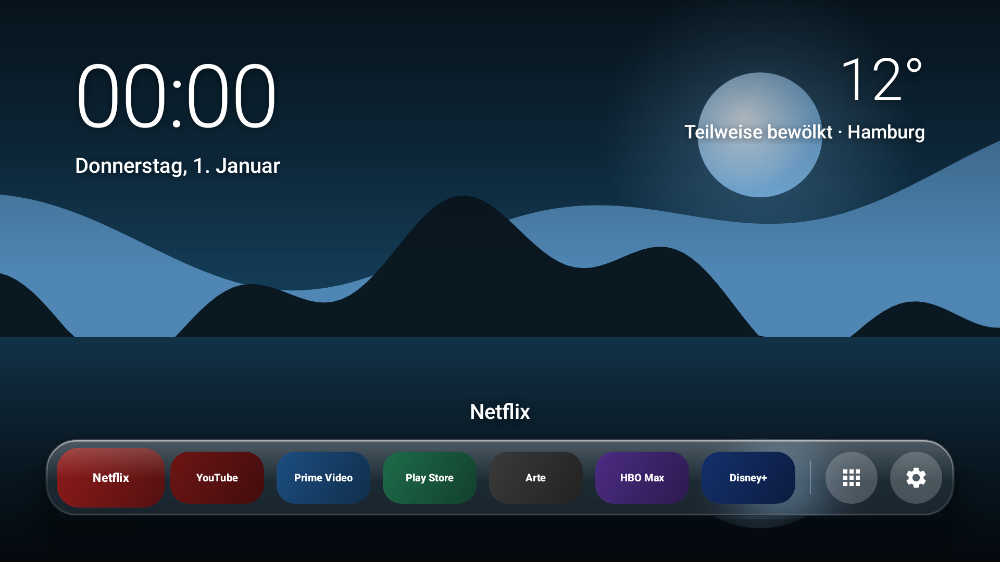
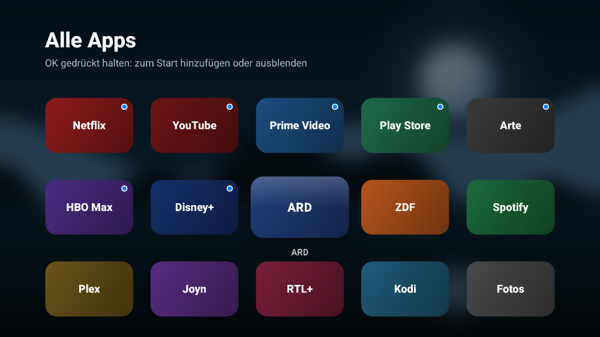
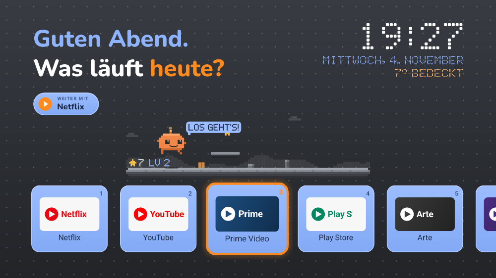

# Klar – werbefreie Startseite für Android TV / Google TV

Eine ruhige Startansicht statt der Android-TV-Oberfläche mit Empfehlungs- und Werbezeilen:
**dein Hintergrundbild, Uhrzeit, Wetter und ein Glas-Dock** mit den wichtigsten Apps
(Netflix, YouTube, Prime Video, Play Store, Arte, HBO Max, Disney+ – sofern installiert).
Am Ende des Docks: **Alle Apps** und **Einstellungen**. Alles andere bleibt aus dem Blick.

Gestaltet nach Apples Liquid-Glass-Richtlinien im Farbschema **Midnight** (tiefes Schwarzblau):

| Ebene | Elemente | Gestaltung |
|---|---|---|
| Bedienebene | Dock, Menüs | Glas: weichgezeichneter, leicht vergrößerter Hintergrund, Glanzlicht, helle Innen- und dunkle Außenkante |
| Inhalt | Hintergrundbild, Uhr, Wetter, Kacheln in „Alle Apps“ | Kein Glas |

- Kein Glas auf Glas: Kacheln und Tasten im Dock sind Füllungen; die fokussierte Taste wird weiß.
- Text auf Glas ist reinweiß; Akzentfarbe (Systemblau) nur für Hauptaktionen und den Punkt „im Dock“.
- Konzentrische Ecken: Dock 30 dp − 12 dp Abstand = 18 dp Kacheln; Menü 28 − 16 = 12 dp.




*Vorschau mit Platzhaltern für Hintergrund und App-Banner.*

**Hinweis:** Echtes Liquid Glass (Lichtbrechung in Echtzeit) gibt es nur auf Apple-Geräten.
Klar bildet es nach; die Unschärfe wird einmalig berechnet, damit es auch auf älteren
Fernsehern flüssig bleibt.

## Design „Abend“ (Standard ab 3.0)

Begrüßung je nach Tageszeit („Guten Abend. Was läuft heute?“), Uhr, Datum und Wetter in
Pixel-Schrift, grauer Hintergrund mit Punkteraster (wie Dot-Grid-Papier), nummerierte Kacheln mit orangem Leuchten bei Fokus, „Weiter mit …“ für die
zuletzt geöffnete App. **Zifferntasten 1–9** der Fernbedienung starten die jeweilige Kachel.
In der Mitte läuft **Pixel**, ein kleines Maskottchen (eigene Figur), in einem Endlos-Jump-and-Run:
rennt über eine Pixel-Laufbahn, springt automatisch über Steine, Kisten und Blöcke, sammelt
Sterne (Zähler über der Bahn), stolpert selten und schläft nachts. Dazu **schwebende Plattformen**
in zwei Höhen, Hügel und Wolken im Hintergrund (Parallax) und **Level**: alle 20 Sterne wird es etwas
schneller. **Selbst spielen:** eine der **Farbtasten** (rot/grün/gelb/blau) oder **0** drücken – dann
steuerst du (jeder Druck = Sprung), nach 20 s ohne Eingabe übernimmt Pixel wieder. Pixel **spricht**
kurze Sprüche in Pixel-Schrift („Los geht's!“, „Autsch!“, „Level 3!“, „Viel Spaß!“) mit Plapper-Lauten.
**App-Symbole** lassen sich einheitlich darstellen (alle Stile außer Original ohne Kachel-Hintergrund, mit orangem Leuchten direkt um das Symbol) (*Einstellungen → App-Symbole*): Original,
Dunkel (helles Logo auf dunklem Grund), Orange oder Blau getönt, Glas Blau und Glas Orange (nur das Logo als Glas frei auf dem Hintergrund, mit orangem Leuchten entlang der Logo-Form, ohne Kachel und ohne Namen) – nur innerhalb von Klar und
der Handy-Fernbedienung; ob ein Banner umgedreht wird, entscheidet sein Rand (= Hintergrund).
**Musik & Sounds:** ein ruhiger, selbst erzeugter Lo-Fi-Loop und Retro-Effekte für Pixel (Sprung,
Stern, Stolpern) – alles per `tools/make_audio.py` synthetisiert, keine fremden Aufnahmen. Läuft leise,
nur solange die Startansicht sichtbar ist, nachts aus; abschaltbar unter *Einstellungen → Musik & Sounds*.
Umschalten zwischen „Abend“ und „Glas“: *Einstellungen → Design* (Auswahlliste, aktives Design markiert).



Schrift: Nunito ExtraBold, SIL Open Font License 1.1 (`app/src/main/assets/fonts/Nunito-OFL.txt`).

## Bedienung

| Wo | Taste | Funktion |
|---|---|---|
| Startansicht | ◀ ▶ | durch das Dock |
| | OK | App öffnen |
| | OK gedrückt halten | Vom Start entfernen · Nach links/rechts · Ausblenden · App-Info |
| | Zurück | zur ersten App im Dock |
| Alle Apps | OK gedrückt halten | Zum Start hinzufügen · Ausblenden · App-Info |
| | Zurück | zur Startansicht |
| überall | Home | Startansicht |

## Handy-Fernbedienung (Web-App)

Klar bringt eine Fernbedienung fürs Handy mit – im Abend-Design (Grau mit Punkteraster, graue Tasten mit leuchtend oranger Umrandung), ohne App-Download.

1. Am Handy (im selben WLAN) öffnen: `http://<IP-des-TVs>:8765`
   (steht auch in Klar unter *Einstellungen → Handy-Fernbedienung*).
2. **PIN anzeigen** antippen – die PIN erscheint auf dem Fernseher – und eingeben.
3. Als App ablegen: iPhone: Safari → *Teilen → Zum Home-Bildschirm*. Android: Chrome → ⋮ → *Zum Startbildschirm hinzufügen*.

Bedienung: **Touchpad** wie bei der Siri Remote (wischen = bewegen, außen tippen = Pfeil,
Mitte tippen = OK, außen halten = wiederholen), Zurück, Home, Play/Pause, Menü, Lautstärke,
Stumm, Eingang, Aus, und **App-Kacheln** zum direkten Starten.

**Pfeile, OK, Zurück, Eingang und Aus** laufen über Sonys Netzwerksteuerung und brauchen einmalig:
*TV-Einstellungen → Netzwerk → Heimnetzwerk-Setup → IP-Steuerung → Authentifizierung
„Normal und Pre-Shared Key“* und einen selbst gewählten Code, den du in der Web-App unter ⚙︎
einträgst. Ohne Code funktionieren App-Start, Home, Play/Pause und Lautstärke.

Sicherheit: nur im Heimnetz erreichbar; ohne PIN-Kopplung gibt es keinen Zugriff, nach 5 falschen
PINs wird eine neue nötig. Gekoppelte Handys lassen sich in Klar unter *Einstellungen →
Handy-Fernbedienung* trennen. Die Verbindung ist unverschlüsselt (HTTP) – für ein privates
Heimnetz in Ordnung, nicht für offene WLANs.

## Eigenes Hintergrundbild

JPG oder PNG, am besten 1920 × 1080. Andere Formate werden mittig zugeschnitten.

```bash
./tools/tv-setup.sh auto wallpaper ~/Downloads/bild.jpg
# oder direkt mit adb:
adb push bild.jpg /sdcard/Android/data/de.klar.tvlauncher/files/hintergrund.jpg
```

Ohne eigenes Bild zeigt Klar einen dunklen Midnight-Verlauf.

Läuft ab Android 5, also auch auf dem **Sony BRAVIA KD-65XD7505** (Android TV 6/7)
und auf neueren Google-TV-Geräten.

- **Große App-Kacheln**, mit der Fernbedienung bedienbar (nutzt die 16:9-Banner der TV-Apps)
- **Anheften & Ausblenden**: OK lange drücken oder Menü-Taste → *An den Anfang heften*,
  *Nach vorne/hinten*, *Ausblenden*, *App-Info*
- **Uhr, Datum & Wetter** (Open-Meteo: ohne Konto, ohne API-Schlüssel)
- **Keine Werbung, keine Empfehlungen, kein Tracking.** Einzige Internetverbindung: das Wetter
  (es wird nur der Ort übertragen). Einstellungen bleiben auf dem Gerät.

## 1. APK bekommen

- Fertig gebaut: Im GitHub-Tab **Actions → „TV-Launcher bauen“** das Artefakt
  `klar-launcher-apk` herunterladen, **oder**
- selbst bauen (Android SDK nötig): `cd tv-launcher && ./gradlew assembleDebug`
  → `app/build/outputs/apk/debug/app-debug.apk`

## 2. Am TV vorbereiten

1. Entwickleroptionen an: 7× auf **Build** klicken – Sony (Android 6/7): *Einstellungen → Info → Build*;
   Google TV: *Einstellungen → System → Über → Android TV OS-Build*.
2. In den *Entwickleroptionen* **USB-Debugging** einschalten (bei Sony ist ADB damit in der Regel auch übers Netzwerk erreichbar; `find-tv.py` zeigt es an).
3. Die IP-Adresse findet `tools/find-tv.py` (siehe 3.) – oder am TV unter *Einstellungen → Netzwerk*.
4. Am Computer [adb (Platform Tools)](https://developer.android.com/tools/releases/platform-tools) installieren.
   Beim ersten Verbinden auf dem TV „Zulassen“ bestätigen.

## 3. Fernseher im Netzwerk finden

Auf einem Computer im **selben Netz** wie der TV (TV eingeschaltet):

```bash
python3 tools/find-tv.py
```

Das Skript fragt per UPnP/SSDP nach Geräten und erkennt Sony-TVs über deren
eingebaute Schnittstelle; notfalls durchsucht es das Heimnetz (/24). Es zeigt IP,
Modell und ob ADB erreichbar ist. In allen Befehlen unten kann statt der IP auch `auto` stehen.

## 4. Einrichten (mit dem Skript)

```bash
./tools/tv-setup.sh auto install           # Klar installieren (TV wird automatisch gesucht)
./tools/tv-setup.sh auto dns               # Werbeblocker-DNS (bei Android < 9: Anleitung)
./tools/tv-setup.sh auto home              # Home-Taste -> Klar (Original-Startseite aus)
./tools/tv-setup.sh auto status            # Kontrolle
```

Danach in Klar im Dock **Einstellungen (Zahnrad) → Wetter-Ort** setzen.

**Alles rückgängig machen:**

```bash
./tools/tv-setup.sh auto restore           # Google-Startseite wieder an
./tools/tv-setup.sh auto dns-off           # DNS wieder automatisch
```

### Warum „home“ nötig ist

Google TV lässt die Home-Taste fest auf die eigene Startseite zeigen, auch wenn ein anderer
Launcher installiert ist. Der Befehl deaktiviert (nicht löscht!) die Google-Startseite für den
Nutzer – dann landet die Home-Taste bei Klar. Hinweise:

- Systemupdates können die Google-Startseite wieder aktivieren → einfach `home` erneut ausführen.
- Einige Google-TV-Funktionen hängen an der Original-Startseite (z. B. Profilwechsel,
  Google-Assistant-Ergebnisseiten, Live-TV-Leiste mancher Hersteller). Sprachsuche in Apps
  und alle Apps selbst funktionieren weiter.
- Wenn etwas hakt: `restore` – danach ist alles wie vorher.

**Ohne ADB / ohne Risiko:** Google TV hat den **„Nur-Apps-Modus“**
(*Einstellungen → Konten & Anmeldung → dein Konto → Nur-Apps-Modus*). Er entfernt alle
Empfehlungen und Werbeflächen aus der Original-Startseite – deutlich ruhiger, aber nicht so
schlicht wie Klar.

### Sony BRAVIA (Android 6/7, z. B. KD-65XD7505)

- „Privates DNS“ gibt es erst ab Android 9. `dns` erkennt das und zeigt stattdessen, wie
  du AdGuard-DNS (`94.140.14.14` / `94.140.15.15`) am TV (statische IP-Einstellungen) oder –
  besser für alle Geräte – im Router einträgst.
- Die Original-Startseite heißt hier `com.google.android.leanbacklauncher`; `home` deaktiviert
  sie, die Home-Taste führt dann zu Klar. Sony-Menüs (Action-Menü, Eingänge, Bild) bleiben.
- Am TV zusätzlich abschalten, falls vorhanden: *Samba Interactive TV* (Inhaltserkennung)
  und Sony-Empfehlungen/Datenschutz-Optionen in den Einstellungen.
- Der TV ist von 2016 und eher langsam: Unschärfe wird deshalb nur einmal berechnet, nicht
  pro Bild, und Animationen bleiben kurz.

## 5. Werbung & Tracking im Netz

| Maßnahme | Wo | Effekt |
|---|---|---|
| Privates DNS `dns.adguard-dns.com` | Skript `dns` | Blockt Werbe- und Tracking-Server systemweit (Banner in Apps, Telemetrie). |
| Werbe-ID löschen | *Einstellungen → Datenschutz → Werbung → Werbe-ID löschen* | Keine personalisierte Werbung über die ID. |
| Nutzungs-/Diagnosedaten aus | *Einstellungen → Datenschutz → Nutzung & Diagnose* | Weniger Daten an Google. |
| Hersteller-Tracking aus | je nach Marke: „Viewing Information“, „Smart-TV-Erfahrung“, „ACR“, „Inhaltserkennung“ (Philips, TCL, Hisense, Sony) | Stoppt die Auswertung, was du schaust. |

Statt AdGuard geht jeder DNS-over-TLS-Anbieter, z. B. `dns.mullvad.net` (Mullvad mit Werbeblocker:
`adblock.dns.mullvad.net`) oder ein eigener Pi-hole/AdGuard Home mit DoT:
`./tools/tv-setup.sh <IP> dns adblock.dns.mullvad.net`.

**Ehrlich gesagt:** DNS-Blocker entfernen **keine YouTube-Werbung** (Werbung und Videos kommen
von denselben Servern) und keine Werbung, die Streamingdienste in ihre Abos einbauen.
Dafür braucht es YouTube Premium bzw. ein werbefreies Abo.

## Entwicklung

```bash
cd tv-launcher
./gradlew testDebugUnitTest   # Unit-Tests (Sortierung, Wetter-Texte)
./gradlew recordPaparazziDebug # Vorschaubild der Startseite neu rendern
./gradlew assembleDebug
```

Aufbau: `MainActivity` (Startansicht mit Dock & Einstellungen), `AppLoader` (installierte Apps), `AppOrder`
(Sortierlogik, getestet), `Weather` (Open-Meteo), `Prefs` (lokale Einstellungen),
`AppsActivity` („Alle Apps“), `AppMenu` (gemeinsame App-Aktionen), `Favorites` (Standard-Dock, getestet),
`Wallpaper` (Hintergrundbild), `Sheet` (Glas-Menüs), `GlassLayout` (Glas-Material),
`Aurora` (Ersatz-Hintergrund + Weichzeichner), `Tint` (App-Farbe für Kacheln).
Fernbedienung: `remote/RemoteHttp` (Server, getestet), `remote/SonyIrcc` (Sony-Tasten),
`remote/AndroidBackend`, `remote/RemoteService`; Web-App in `app/src/main/assets/remote/`.
